<div align="center">

# CSC 417 · GROUP PROJECT

## Aurum — Personal Finance & Wealth Tracker

**Moi University, Kenya · Undergraduate group project**

**A premium, production-shaped mobile application built with React Native & Expo, for Kenyan money.**

React Native · Expo SDK 58 · TypeScript · Reanimated 4 · Zustand · React Navigation

<br />


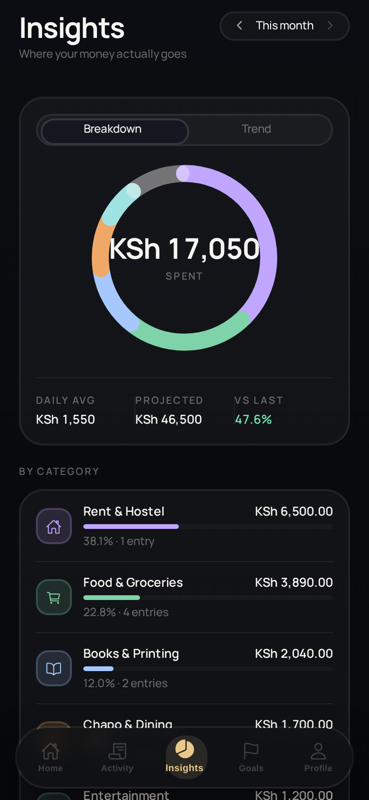
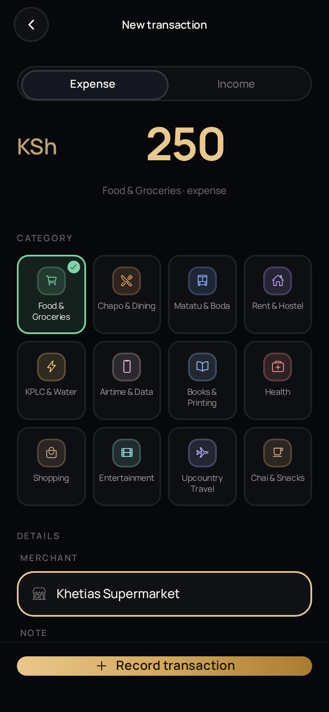

</div>

> **Institution:** Moi University, Eldoret, Kenya · **Course unit:** CSC 417 · **Submission type:**
> Undergraduate Group Project · **Academic year:** 2025 / 2026
>
> **Deliverable:** A complete cross-platform mobile personal-finance app — onboarding,
> authentication, five feature tabs, full CRUD across five domains, animated data visualisation,
> offline-first persistence, and light/dark theming. Kenyan shillings by default, with M-Pesa,
> bank and Sacco accounts, HELB upkeep and campus life in Eldoret as the demo scenario.

## Live web demo

[Open Aurum on GitHub Pages](https://leymarmuth.github.io/csc417-group-project-finance-app/)
— no download or local setup is required.

Choose **Sign in → Use the demo account → Sign in** to explore the sample ledger.
The browser demo uses local sample data; it does not connect to real bank or M-Pesa accounts.

---

## Table of contents

1. [Project overview](#1-project-overview)
2. [Project context — Moi University, Kenya](#2-project-context--moi-university-kenya)
3. [Feature tour](#3-feature-tour)
4. [Screens gallery](#4-screens-gallery)
5. [CRUD specification](#5-crud-specification)
6. [Architecture](#6-architecture)
7. [Design system](#7-design-system)
8. [Motion & interaction design](#8-motion--interaction-design)
9. [Technology stack](#9-technology-stack)
10. [Running the project](#10-running-the-project)
11. [Project structure](#11-project-structure)
12. [Course requirements mapping](#12-course-requirements-mapping)
13. [Quality & verification](#13-quality--verification)
14. [Limitations & future work](#14-limitations--future-work)
15. [Academic integrity declaration](#15-academic-integrity-declaration)

---

## 1. Project overview

**Aurum** is a personal finance and wealth-tracking application for iOS and Android, written in
TypeScript with React Native (Expo). It is not a prototype or a collection of disconnected
screens: it is a single, coherent product with a full navigation graph, a persistent data layer,
a token-driven design system, and consistent interaction language throughout.

The app tracks money the way a careful person thinks about it:

- **Accounts** — where the money sits (M-Pesa, bank, Sacco, card, cash, money market)
- **Transactions** — what moved, when, and from which account
- **Categories** — the vocabulary for _why_ money moved
- **Budgets** — a monthly ceiling per category
- **Goals** — what you are saving towards, and how far along you are

Three months of believable Kenyan sample data is generated on first launch, so every chart, budget
ring and insight has something real to display immediately. A demo account is pre-seeded and can
be filled in with one tap on the sign-in screen.

All money is Kenyan Shillings, held as integer cents and formatted for the `en-KE` locale — so
`KSh 1,250` is stored as `125000`, never as a float.

### Why this topic

Personal finance is an unusually demanding domain for a mobile application: it requires correct
state management (a transaction affects an account balance; editing or deleting it must reverse
that effect), strict presentation of money as integer minor units, several genuinely different
visualisations, and privacy-conscious local storage. That makes it a strong vehicle for
demonstrating the course's learning outcomes rather than a trivial CRUD exercise.

---

## 2. Project context — Moi University, Kenya

This application is the CSC 417 group project submission of an undergraduate group at **Moi
University, Eldoret, Kenya**. It was designed for the financial reality its authors actually live
in, not for a generic American demo:

| Decision                | What we did, and why                                                                                                                                                                       |
| ----------------------- | ------------------------------------------------------------------------------------------------------------------------------------------------------------------------------------------ |
| **Currency**            | **Kenyan Shilling (KSh)** is the default everywhere — seed data, budgets, goals and formatting. Eight other currencies remain selectable in Settings.                                      |
| **Money channels**      | Accounts model how Kenyan students actually hold money: **M-Pesa**, a **bank account** (Equity), a **Sacco** savings account (Moi University Sacco), a card, cash and a money-market fund. |
| **Income**              | **HELB disbursements**, upkeep from home, and freelance gigs — not a US salary.                                                                                                            |
| **Spending vocabulary** | Categories match campus life: Food & Groceries, Chapo & Dining, Matatu & Boda, Rent & Hostel, KPLC & Water, Airtime & Data, Books & Printing, Chai & Snacks, Upcountry Travel.             |
| **Demo data**           | Three months of believable Eldoret activity — Khetias and Naivas runs, matatu fare to Kesses, KPLC prepaid tokens, printing at the ICT Centre, Easy Coach to Nairobi.                      |
| **Goals**               | Saving for a laptop for final year, a hostel deposit, and a graduation gown.                                                                                                               |
| **Persona**             | The demo account belongs to a Kenyan undergraduate; a fresh registration starts from the same seeded ledger.                                                                               |

The point is deliberate: an app that shows `$82,447.60` in a Nairobi hostel is a mock-up, while an
app that shows `KSh 182,080` across M-Pesa, Equity and a Sacco is a product someone could actually
use. Adapting the product to its local context is listed as a learning outcome in
[`src/constants/project.ts`](src/constants/project.ts).

## 3. Feature tour

### 3.1 Onboarding

Three full-height slides with parallax product fragments, animated pager dots and a routing split
into _Create account_ or _Sign in_. The pager is driven by a single `useAnimatedScrollHandler`
shared value, so the parallax, opacity and dot interpolation all run on the UI thread.

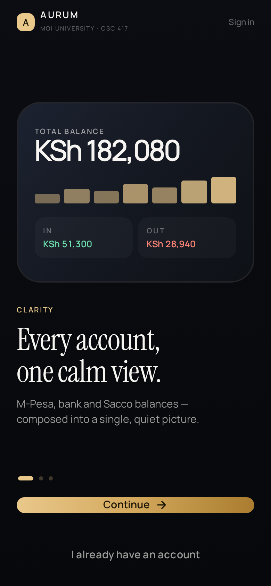 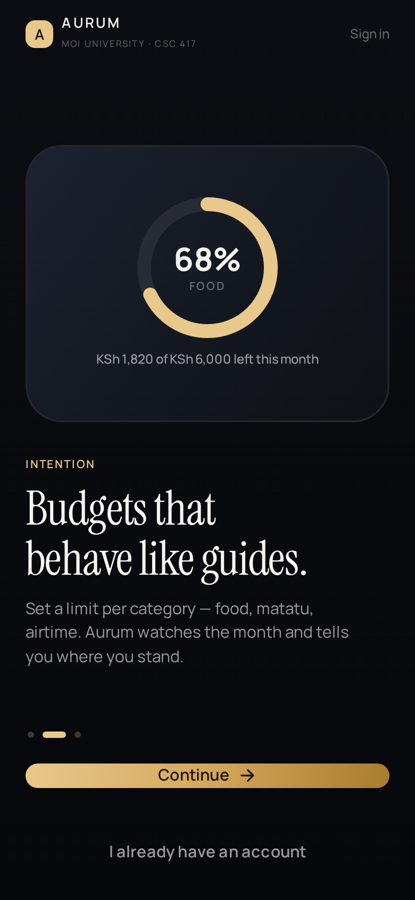

### 3.2 Authentication & session management

- **Sign in** with inline validation that only surfaces after a field is blurred or the form is
  submitted — errors never shout while the user is still typing.
- **Sign up** with a live, weighted password-strength model (length, mixed case, number, symbol)
  rendered as an animated four-segment meter, plus a terms gate.
- **Password recovery** with a genuine success state rather than a dead end.
- **Session persistence:** the token is written to `expo-secure-store` (iOS Keychain / Android
  Keystore) and the session is restored on launch, with expiry checking. "Keep me signed in" is a
  real toggle that decides whether that write happens.
- The auth client is shaped exactly like an HTTP service — async, with simulated latency and
  **typed error codes** (`invalid_credentials`, `email_taken`, …). Replacing it with `fetch` calls
  requires no changes anywhere else in the app.

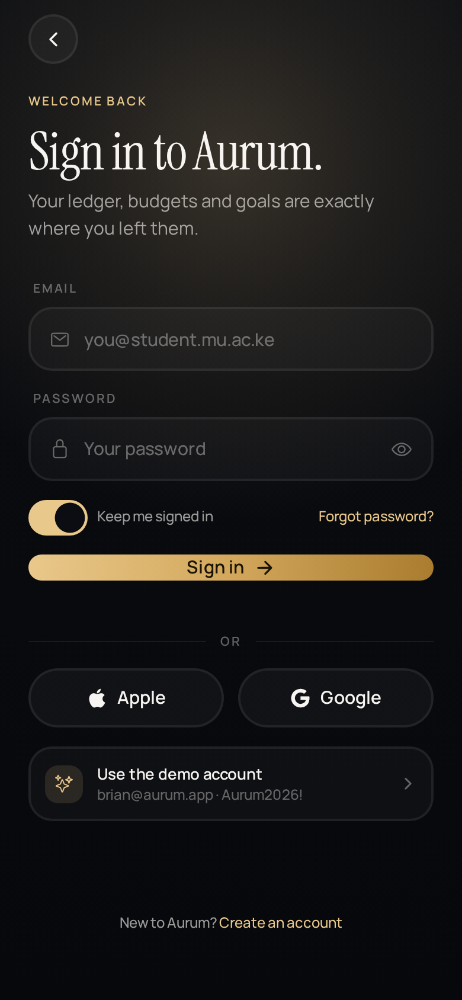

### 3.3 Home


The balance hero is the app's signature surface: money set as typography (small symbol and
decimals, large whole units), a count-up animation on every value change, a six-month sparkline,
month in/out totals, and a privacy eye that masks every balance in the app in one tap.

Below it: an account carousel, a cumulative-spend area chart with a month switcher, budget
progress rings, recent activity with swipe-to-delete, and goal cards that open straight into the
editor.

<br clear="right" />

### 3.4 Activity — search, filter, delete

- Debounced search across merchant, note and category name.
- A **filter sheet** combining direction (income/expense), period (any month or all time),
  categories (multi-select) and accounts (multi-select), with an active-filter count on the button.
- Results grouped by day with per-day net totals.
- **Swipe-to-delete** with velocity-aware dismissal and a full-swipe shortcut.
- Every delete is reversible: the removal returns the entity and raises an undo toast.

### 3.5 Insights — analysis and budgets


- **Segmented donut** of spend by category where each arc sweeps in with a stagger, showing the
  month total in the centre.
- **Paired bar chart** of income vs. spend across six months.
- Derived figures: daily average, end-of-month projection, month-on-month change, largest single
  expense, number of spending days, and amount saved.
- **Budget CRUD**: create or edit a monthly limit per category, see spent/remaining, over-budget
  states, and remove a budget with undo.

<br clear="right" />

### 3.6 Goals

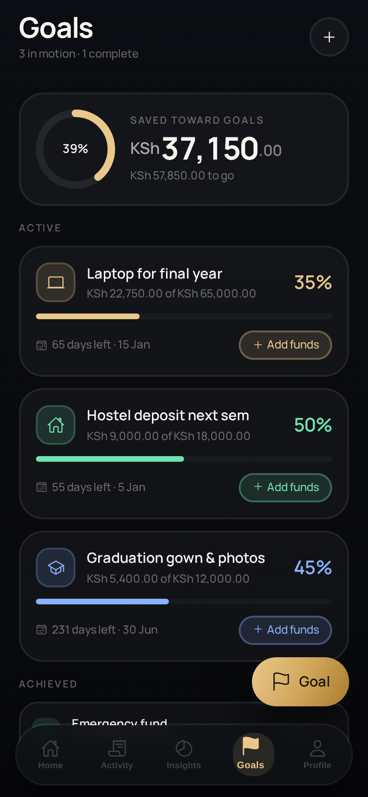 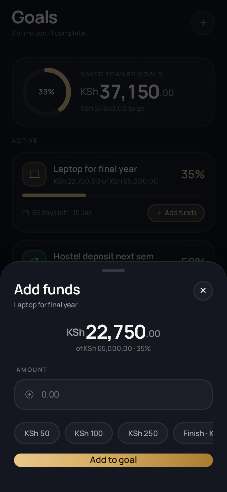

Create a goal with a name, target, current amount, icon, colour and deadline preset; contribute to
it from a sheet with quick amounts (including a "Finish" amount that closes the gap exactly);
archive it without losing progress; delete it with undo. Values are clamped so a goal can never
overshoot its target.

### 3.7 Accounts & categories

Full CRUD for both, with **referential integrity enforced in the data layer**:

- An account holding transactions cannot be deleted — the attempt returns a typed error that the
  UI surfaces as a toast.
- A category still referenced by transactions or budgets cannot be deleted.
- At least one active account must always remain.
- Accounts can be archived instead of deleted (history preserved, excluded from balances).
- Categories show real usage statistics (entry count, total, whether a budget exists).

### 3.8 Settings, profile and privacy

Appearance (system / light / dark), eight selectable currencies (KSh by default), hide-balances
privacy mode, haptics, weekly digest, demo-data reset, password change, and the course-project
_About_ sheet.

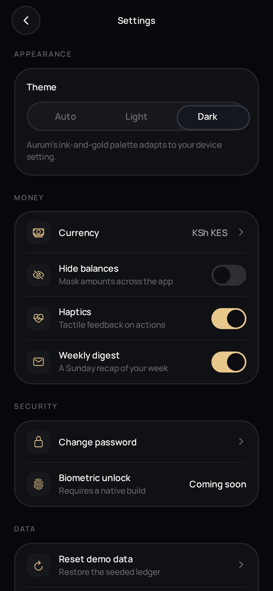 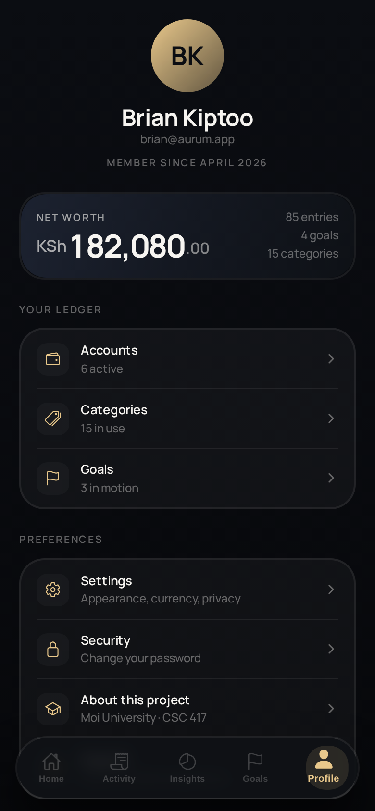

---

## 4. Screens gallery

All images below are real screenshots of the running application (captured from the
`react-native-web` build through a headless browser at iPhone-class resolution).

| Home                                                   | Insights                                                   | Activity                                                   | Transaction editor                                                   |
| ------------------------------------------------------ | ---------------------------------------------------------- | ---------------------------------------------------------- | -------------------------------------------------------------------- |
|  |  | 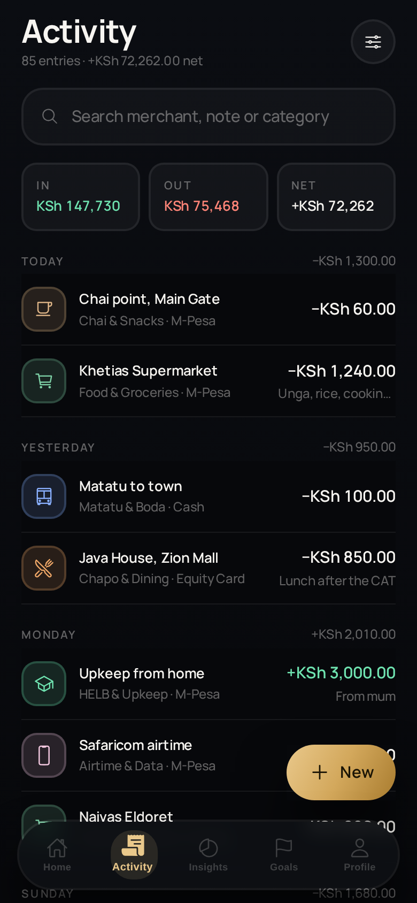 |  |

| Onboarding                                                   | Onboarding · budgets                                                 | Onboarding · goals                                                 | Sign in                                                   |
| ------------------------------------------------------------ | -------------------------------------------------------------------- | ------------------------------------------------------------------ | --------------------------------------------------------- |
|  |  | 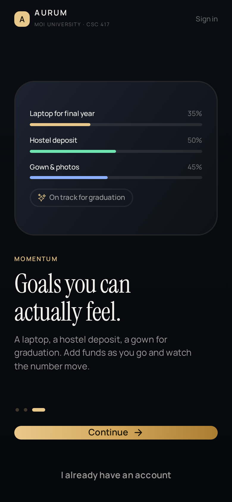 |  |

| Goals                                                   | Add funds                                                   | Profile                                                   | Settings                                                   |
| ------------------------------------------------------- | ----------------------------------------------------------- | --------------------------------------------------------- | ---------------------------------------------------------- |
|  |  |  |  |

| About this project (CSC 417)                                    | Home after a new transaction                                             |
| --------------------------------------------------------------- | ------------------------------------------------------------------------ |
| 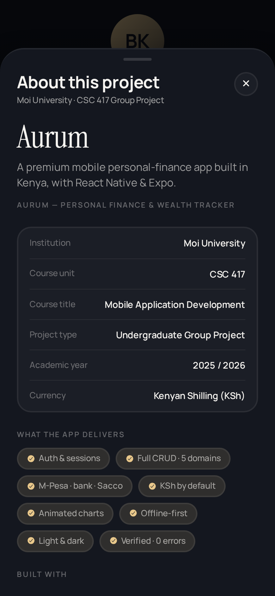 | 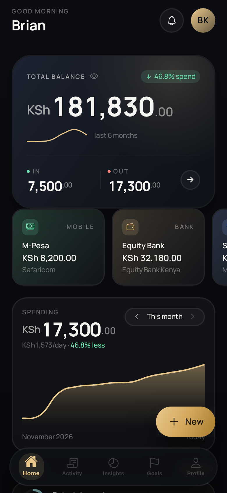 |

---

## 4.1 Where CSC 417 appears inside the app

The course identity is not only a README badge — it is part of the product surface, so that anyone
opening the application knows what they are looking at.

| Location                       | What is displayed                                                                              | Source                                     |
| ------------------------------ | ---------------------------------------------------------------------------------------------- | ------------------------------------------ |
| Onboarding wordmark            | `MOI UNIVERSITY · CSC 417` under **AURUM**                                                     | `OnboardingScreen`                         |
| Launcher splash                | `CSC 417 · GROUP PROJECT · MOI UNIVERSITY`                                                     | `components/system/Launcher`               |
| Profile → _About this project_ | Institution, course unit, project type, academic year, default currency, what the app delivers | `features/profile/components/ProjectSheet` |
| Settings → _Course project_    | About this project · Course unit · Tech stack                                                  | `SettingsScreen`                           |
| Settings footer                | `Aurum 1.0.0 · CSC 417 Group Project · Moi University`                                         | `SettingsScreen`                           |
| Profile footer                 | `Aurum 1.0.0 · CSC 417 Group Project · Moi University`                                         | `ProfileScreen`                            |
| App entry point                | File header declaring the module as the CSC 417 group project                                  | `App.tsx`                                  |
| App configuration              | `expo.description`, `expo.extra.courseCode`                                                    | `app.json`                                 |
| Package manifest               | `name`, `description`, `keywords`                                                              | `package.json`                             |

Every value lives in one module — [`src/constants/project.ts`](src/constants/project.ts) — so the
course details are changed once and appear everywhere.

 

---

## 5. CRUD specification

Every entity supports the four operations, enforced in the data layer rather than by hiding buttons.

| Entity           |    Create     |          Read          |    Update     |     Delete      | Integrity rules & notes                                                                                                       |
| ---------------- | :-----------: | :--------------------: | :-----------: | :-------------: | ----------------------------------------------------------------------------------------------------------------------------- |
| **Transactions** | Editor screen | Activity, Home, editor | Editor screen | Swipe + confirm | Creating/editing/deleting re-balances the owning account (`−oldDelta`, `+newDelta`); undo restores the entity and the balance |
| **Categories**   |     Sheet     | Grid, filters, pickers |     Sheet     | Sheet + confirm | Blocked while any transaction or budget references it                                                                         |
| **Accounts**     | Editor screen |  List, home carousel   | Editor screen |     Confirm     | Blocked while transactions reference it; at least one active account required; archive instead of delete                      |
| **Budgets**      |     Sheet     |     Insights, home     |     Sheet     | Confirm + undo  | One budget per category per month (upsert semantics)                                                                          |
| **Goals**        | Editor screen |      Cards, home       | Editor screen | Confirm + undo  | Contribution clamped to `[0, target]`; archive supported                                                                      |

All writes are **optimistic**: state is updated in memory immediately and persisted through a
debounced write-behind flush (320 ms). Deletes and destructive edits return the affected entity so
the UI can offer a real undo rather than an apology.

---

## 6. Architecture

```
┌──────────────────────────────────────────────────────────────┐
│  features/*          screens + feature-local components       │
│  components/*        design-system kit, charts, primitives    │
├──────────────────────────────────────────────────────────────┤
│  store/*             zustand stores (state + actions)         │
│  store/selectors.ts  pure derivations over state              │
├──────────────────────────────────────────────────────────────┤
│  services/*          auth client, ledger repository, storage  │
├──────────────────────────────────────────────────────────────┤
│  types · lib         domain models, formatting, validation    │
│  theme · constants   design tokens + course metadata          │
└──────────────────────────────────────────────────────────────┘
```

Dependencies only point downward: a screen may read a store, a store may call a service, a service
may touch storage. Nothing in `services/` imports React, which is what keeps the data layer
testable and portable.

### State ownership

| Store              | Owns                                                                               | Persistence                           |
| ------------------ | ---------------------------------------------------------------------------------- | ------------------------------------- |
| `useAuthStore`     | session status (`booting` / `signedOut` / `signedIn`), user, pending & error flags | token in `expo-secure-store`          |
| `useLedgerStore`   | accounts, categories, transactions, budgets, goals + every mutation                | write-behind snapshot in AsyncStorage |
| `useSettingsStore` | theme mode, currency, privacy, haptics, digest                                     | AsyncStorage                          |
| `useToastStore`    | transient toast queue                                                              | none                                  |

`status: 'booting'` is what keeps the animated launcher on screen until the session has been
resolved — a signed-in user never flashes past a sign-in screen on cold start.

### The mutation pattern

Every CRUD action follows one shape (from `src/store/useLedgerStore.ts`):

```ts
createTransaction: async (draft) => {
  if (!draft.amount || draft.amount <= 0)
    throw new LedgerError('invalid', 'Enter an amount greater than zero.');

  const transaction = { ...draft, id: uid('txn'), createdAt: now, updatedAt: now };

  commit((state) => ({
    transactions: [transaction, ...state.transactions],
    accounts: adjustAccount(state.accounts, transaction.accountId, balanceDelta(transaction)),
  }));

  return transaction; // callers toast/navigate with the result
};
```

`commit` = update state now, schedule a debounced persist. The same pattern gives us optimistic
writes, undo, and a single place to enforce invariants.

### Error taxonomy

`LedgerError.code`: `invalid` · `duplicate` · `in_use` · `not_found` · `persist`
`AuthError.code`: `invalid_credentials` · `email_taken` · `not_found` · `network` · `unknown`

Screens display the message and only branch on the code when behaviour differs (for example, a
duplicate category warns differently from a successful create).

### Selectors

Every derived value lives in `src/store/selectors.ts` as a pure function over plain data:
`monthTotals`, `spendByCategory`, `dailySpendSeries`, `monthlySeries`, `budgetProgress`,
`filterTransactions`, `percentChange`, `goalProgress`, `totalBalance`. Screens call them inside
`useMemo` with the primitive slices they subscribe to, keeping renders narrow and the logic
unit-testable without a renderer.

A deeper write-up is in [`docs/ARCHITECTURE.md`](docs/ARCHITECTURE.md).

---

## 7. Design system

No screen hard-codes a colour, a duration, a radius or a font size — everything is a token in
[`src/theme/tokens.ts`](src/theme/tokens.ts).

| Category       | Definition                                                                                                                                                                                                                                           |
| -------------- | ---------------------------------------------------------------------------------------------------------------------------------------------------------------------------------------------------------------------------------------------------- |
| **Palette**    | An ink ramp (`#07080B → #242A35`) for dark mode, a warm parchment ramp for light mode, and a signature metal (gold) ramp in five steps. Semantic colours (positive, negative, info, warning) are defined per theme and never reused across meanings. |
| **Typography** | `Manrope` for interface text; `Instrument Serif` for display. Money uses tabular figures with a typographic split — small symbol and decimals, large whole units.                                                                                    |
| **Spacing**    | 2 / 4 / 8 / 12 / 16 / 20 / 24 / 32 / 40 / 56                                                                                                                                                                                                         |
| **Radius**     | 6 → 34, plus a pill token                                                                                                                                                                                                                            |
| **Elevation**  | Three shadow recipes (card, raised, floating), tuned separately per theme                                                                                                                                                                            |
| **Motion**     | Four spring presets (`snappy`, `gentle`, `silky`, `bouncy`), five durations, one 55 ms stagger constant                                                                                                                                              |

The in-house component kit (`src/components/ui`) ships: `Screen`, `Card`, `Text`, `Button`,
`Input`, `Sheet`, `Chip`, `Switch`, `SegmentedControl`, `ProgressRing`, `Skeleton`, `EmptyState`,
`Badge`, `ListRow`, `IconButton`, `Avatar`, `Fab`, `Toaster`, `AmbientGlow` and `PressableScale`.
No third-party UI library is used.

---

## 8. Motion & interaction design

| Interaction   | Implementation                                                                                                                     |
| ------------- | ---------------------------------------------------------------------------------------------------------------------------------- |
| Boot          | Monogram springs in behind the native splash while fonts, settings, ledger and session hydrate in parallel                         |
| Onboarding    | `useAnimatedScrollHandler` parallax with per-slide opacity and interpolated pager dots                                             |
| Tap feedback  | `PressableScale` — spring compression on press-in, scale-in on release, haptic on press                                            |
| Money         | Shared value → `useAnimatedReaction` → `runOnJS`, so values interpolate without re-rendering parents every frame                   |
| Charts        | `useAnimatedProps` driving `strokeDashoffset` / bar heights with staggered delays                                                  |
| Tab bar       | One shared index value drives both the floating pill position and each icon's lift and opacity                                     |
| Bottom sheets | Gesture-driven `translateY` with velocity-aware dismissal, and a mounted state that outlives `visible` so exit animations complete |
| Lists         | `FadeInDown` mount staggers, `Layout` transitions on reorder                                                                       |
| Skeletons     | Breathing opacity while the ledger hydrates                                                                                        |
| Toasts        | `FadeInUp` in, `LinearTransition` reflow, auto-dismiss with an undo action                                                         |

Two rules: (1) anything continuous runs on the UI thread as a worklet; (2) data is pushed back to
JS with `runOnJS` at the frame boundary, never per frame.

---

## 9. Technology stack

| Layer       | Choice                                                        | Why                                                              |
| ----------- | ------------------------------------------------------------- | ---------------------------------------------------------------- |
| Runtime     | Expo SDK 58 / React Native 0.88 / React 19 (New Architecture) | Fast iteration, OTA-ready, one codebase for iOS & Android        |
| Language    | TypeScript (strict)                                           | Compile-time safety across the whole data layer                  |
| Animation   | Reanimated 4 + Gesture Handler + worklets                     | 60 fps animations and gestures off the JS thread                 |
| State       | Zustand                                                       | Minimal, hook-based, no provider tree; easy to keep actions pure |
| Persistence | AsyncStorage + expo-secure-store                              | Offline-first; tokens isolated in Keychain/Keystore              |
| Navigation  | React Navigation (native stack + bottom tabs)                 | Predictable native transitions, custom tab bar                   |
| Graphics    | react-native-svg (hand-built charts)                          | Full control of chart geometry and animation                     |
| Type        | Manrope + Instrument Serif via expo-google-fonts              | Editorial display paired with a precise UI face                  |
| Tooling     | ESLint (expo config), Prettier, GitHub Actions                | Lint/format/typecheck gates on every push                        |

---

## 10. Running the project

```bash
# 1. Install dependencies
npm install

# 2. Start the dev server
npx expo start          # press i (iOS), a (Android) or w (web), or scan the QR with Expo Go
```

**Demo credentials** (the sign-in screen can fill these in with one tap):

```
email:    brian@aurum.app
password: Aurum2026!
```

Registering a fresh account also works — it lands on the same seeded three-month Kenyan ledger.

### Scripts

| Command                           | Purpose                                 |
| --------------------------------- | --------------------------------------- |
| `npm run start`                   | Expo dev server                         |
| `npm run ios` / `npm run android` | Open on a simulator/emulator            |
| `npm run web`                     | Run in a browser via `react-native-web` |
| `npm run typecheck`               | `tsc --noEmit` (strict)                 |
| `npm run lint`                    | ESLint over the whole project           |
| `npm run format`                  | Prettier                                |
| `npm run export:web`              | Static web build (used for screenshots) |

> **Web build note:** the browser version exists for design review and continuous-integration
> checks. Haptics and the secure enclave are unavailable there and degrade gracefully; the app is
> designed first for iOS and Android.

---

## 11. Project structure

```
.
├── App.tsx                    # boot sequence: fonts → hydrate → navigation
├── app.json                   # Expo configuration (icons, splash, plugins)
├── babel.config.js            # babel-preset-expo + worklets plugin
├── src/
│   ├── constants/project.ts   # CSC 417 course metadata + group members
│   ├── theme/                 # tokens + ThemeProvider (light / dark / system)
│   ├── types/models.ts        # domain models
│   ├── lib/                   # formatting, dates, validation, form engine, haptics
│   ├── services/              # storage tiers, auth client, ledger repository
│   ├── data/seed.ts           # three-month sample ledger
│   ├── store/                 # zustand stores + pure selectors
│   ├── components/
│   │   ├── ui/                # design-system kit
│   │   ├── charts/            # area, bar, donut, sparkline (hand-built SVG)
│   │   ├── finance/           # money display, category icon, month switcher
│   │   └── system/            # animated launcher
│   ├── features/
│   │   ├── onboarding/  auth/  home/  transactions/
│   │   └── insights/    goals/ accounts/  profile/
│   └── navigation/            # root / auth / tab navigators + custom tab bar
├── docs/
│   ├── ARCHITECTURE.md        # engineering design notes
│   ├── PROJECT.md             # course submission report
│   └── screenshots/           # 11 captured screens
└── .github/workflows/ci.yml   # typecheck + web bundle on push
```

---

## 12. Course requirements mapping

| Learning outcome                                          | Where it is demonstrated                                                                              |
| --------------------------------------------------------- | ----------------------------------------------------------------------------------------------------- |
| Design and build a complete, navigable mobile application | Full navigation graph: onboarding → auth stack → 5 tabs → 7 pushed/modal screens                      |
| Apply a consistent design system and accessible patterns  | Design tokens, in-house component kit, accessibility roles/labels/states on every interactive element |
| Implement persistent, offline-capable CRUD with integrity | Zustand + repository + storage tiers; guarded deletes; optimistic writes; undo                        |
| Use animation purposefully                                | Motion inventory in §8 — every animation communicates state, hierarchy or causality                   |
| Work as a team with clear ownership                       | Module ownership table in §2 and in the in-app _About this project_ sheet                             |

---

## 13. Quality & verification

| Check                 | Command                             | Result                                                                                                         |
| --------------------- | ----------------------------------- | -------------------------------------------------------------------------------------------------------------- |
| Type safety           | `npm run typecheck`                 | ✅ clean (strict mode, no `any` escapes in app code)                                                           |
| Lint                  | `npm run lint`                      | ✅ 0 errors, 0 warnings                                                                                        |
| Formatting            | `npm run format`                    | Prettier, enforced                                                                                             |
| iOS bundle            | `npx expo export --platform ios`    | ✅ Hermes bundle produced                                                                                      |
| Web bundle            | `npm run export:web`                | ✅ static build produced                                                                                       |
| End-to-end smoke flow | headless browser over the web build | ✅ onboarding → sign in → create transaction → filter → insights → goals → settings, with **0 console errors** |

The screenshots in this README were produced by that same headless-browser run, so they reflect
the shipped code rather than a mock-up.

---

## 14. Limitations & future work

- The backend is **mocked locally** (`services/auth.service.ts`, `services/ledger.repository.ts`)
  so the app is fully functional offline and markable without infrastructure. Both files are the
  only integration points for a real API.
- Biometric unlock is scaffolded in Settings but requires `expo-local-authentication` in a native
  build.
- Not yet implemented: recurring transactions, cash-flow forecasting, CSV import/export,
  multi-currency conversion with historical rates, M-Pesa statement import, and home-screen
  widgets.
- No automated unit tests yet — verification is currently type, lint and end-to-end smoke level.
  Selectors were deliberately written as pure functions so a Jest suite can be added cheaply.

---

## 15. Academic integrity declaration

This application was designed and implemented by an undergraduate group at **Moi University,
Kenya**, for the course unit **CSC 417**. Third-party open-source libraries are used under their respective licences and
are declared in `package.json`; all application code, design tokens, chart geometry, component
implementations and the sample dataset were written by the group. No third-party UI kit or chart
library was used to produce the interface.

---

<div align="center">

MIT licensed · CSC 417 group project · Moi University, Kenya · 2025 / 2026

</div>
